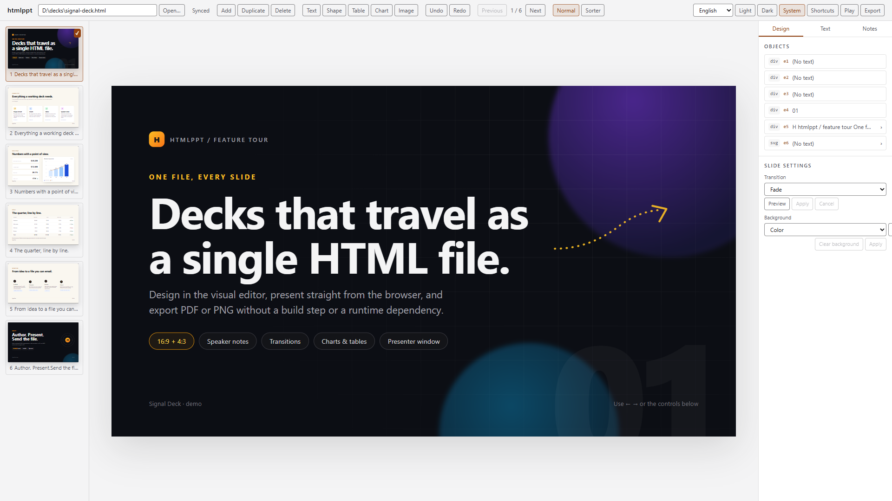
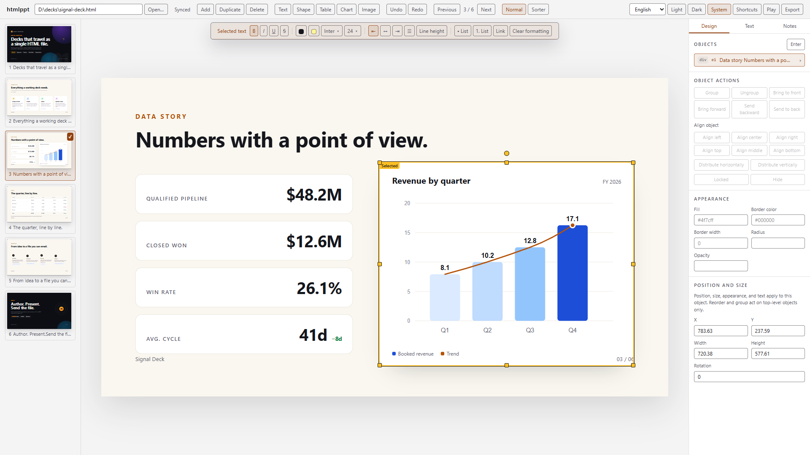
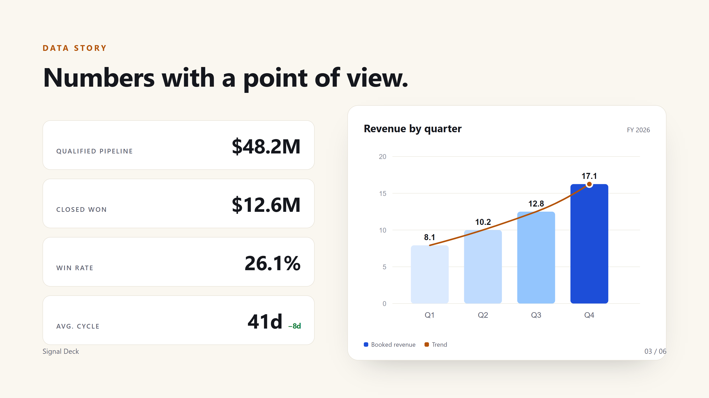

# htmlcraft

A local visual editor and CLI/MCP toolchain for single-file HTML presentations.

An agent writes one self-contained HTML deck that follows the
[`htmldeck/v1` contract](docs/contract.md). A person opens the same file in a
local editor, adjusts layout and copy, and exports standalone HTML, PDF, or one
PNG per slide. There is no project file, build step, or upload; the HTML file
is the source of truth.



## Install

Requires Node.js 20 or newer. PDF and PNG export need a local Chrome, Edge, or
Chromium build.

```bash
npm install -g htmlcraft
npx -y htmlcraft --help
```

From a source checkout, run `npm ci && npm run build` first, then use the same
commands through `npx htmlcraft`.

## Updates

The CLI and MCP server check the public npm registry at most once a day — when
the cached result is older than 24 hours; a failed check is retried on the next
run — and print a one-line notice when a newer release exists. Nothing is
installed or upgraded automatically. Set `HTMLCRAFT_NO_UPDATE_CHECK=1` (or run
in CI) to disable the check; the only request is a `GET` for the package's
latest version and no identifiers are sent.

## Quick start

```bash
npx htmlcraft new deck.html --title "Quarterly review" --slides 3
npx htmlcraft validate deck.html
npx htmlcraft open deck.html
npx htmlcraft stop deck.html
```

`new` refuses to overwrite an existing file; pass `--force` to replace it.
`--size 1600x900` sets the canvas. `open` prints
`HTMLCRAFT_URL=http://127.0.0.1:<port>/?token=...` and opens your browser;
`--no-browser` prints the URL only.

The token is exchanged for an HttpOnly, `SameSite=Strict` session cookie and
removed from the address bar. `open` reuses the recorded token and port, so the
URL stays valid while the host runs; `stop` rotates the token. The full model is
in [SECURITY.md](SECURITY.md).

To switch a running host to another deck, type its path into the editor's path
field and press Enter. Relative paths, quoted paths, `~`, and `file://` URLs are
accepted. A successful switch keeps the host and token, moves the credential to
the new deck, and writes saves to the new file.

## MCP

Add the stdio server to an MCP client:

```json
{
  "mcpServers": {
    "htmlcraft": {
      "command": "npx",
      "args": ["-y", "htmlcraft@latest", "mcp"]
    }
  }
}
```

With a global install, `"command": "htmlcraft-mcp"` works too. The server exposes
25 tools and the `htmlcraft://contract`, `htmlcraft://authoring`, and
`htmlcraft://example` resources. See [docs/mcp.md](docs/mcp.md) for the full
surface.

Agent loop:

1. Read `get_deck_contract` or the `htmlcraft://contract` and
   `htmlcraft://authoring` resources.
2. Create a deck with `create_deck`, or inspect an existing one with
   `get_outline`, `read_slide`, and `get_element`. Do not guess ids.
3. Mutate one change per call (`set_text`, `set_style`, `add_slide`,
   `add_image`, `add_table`, `update_chart`, and so on), then validate.
4. Hand the deck to a person with `open_editor`, or export it with
   `export_deck`. A `conflict` means re-read, reconcile, and retry; never
   overwrite the whole file.

The CLI uses the same files and contract and is the fallback for scripts and
exit codes.

## Editor



- **Slides:** add, duplicate, delete, thumbnail rail, drag-to-reorder sorter,
  slide counter, zoom.
- **Text:** inline editing, bold, italic, underline, strikethrough, color,
  highlight, font family, size, alignment, line height, lists, links, clear
  formatting.
- **Objects:** text boxes, shapes, images (upload or URL), tables, charts.
  Select, multi-select, drag, resize with snapping and guides, rotate, nudge,
  align/distribute, group/ungroup, change stacking order, lock, hide,
  copy/paste/duplicate/delete, undo/redo.
- **Components:** a click selects the innermost visible component (heading,
  card, tab, step, icon, chart, SVG shape) and moves it in place. Duplicate,
  delete, and copy/paste work inside the parent. Table cells and
  CSS-transformed SVG shapes explain why they do not move.
- **Inspector:** position, size, rotation, fill, stroke, radius, opacity, shape
  text, image alt text and crop, image replacement, chart JSON, slide
  background, transition preview, speaker notes.
- **Present:** fullscreen play with authored transitions, plus a presenter
  window with notes, next-slide preview, and timer over `BroadcastChannel`.
- **Persistence:** 800 ms autosave, live updates from disk or MCP, a conflict
  banner with reload/overwrite, crash-recovery drafts, and an upload/download
  fallback without a host.
- **Theme and language:** Light, Dark, and System editor chrome; English,
  Traditional Chinese, and Simplified Chinese. Slide content, play mode,
  presenter view, and exported controls keep their own styling.
- **Keyboard:** save, undo/redo, nudge, group, zoom, play, and `?` for the
  shortcut reference.

Layout containers can be entered. Use the OBJECTS chevron or double-click the
container's padding or background; Enter enters a selected container and Escape
leaves one level. Nested objects support move, resize, rotate, nudge, and
appearance or text edits. The first position, size, or rotation edit pins a flow
object to absolute positioning. Structural commands stay at the top level.

## The `htmldeck/v1` contract

| Part | Contract | Notes |
| --- | --- | --- |
| Deck wrapper | `<main data-ppt-deck>` | Generated decks include it; detection tolerates legacy decks. |
| Slide | `section[data-slide-id]` | Ids are unique and non-empty. Class-only slides work but have no stable address. |
| Canvas | `data-width`, `data-height` | Optional positive pixel numbers; omit both for 1600x900. Keep one size per deck. |
| Object | `data-ppt-el="e1"` | Unique within the slide and stable across edits; nested ids share the rule. |
| Speaker notes | `<aside data-ppt-notes hidden>` | Optional direct child of the slide. |
| Transition | `data-ppt-transition` | Optional: `none`, `fade`, or `slide`. |
| Runtime | `<script data-ppt-runtime="1">` | Exactly one script with the real runtime body; required for a standalone multi-slide deck. |
| Charts | `<figure data-ppt-chart='...'>` | Valid JSON with `type`, `labels`, and `series`; the SVG is derived from it. |
| Groups | `data-ppt-group` | Optional wrapper for related objects; nesting group wrappers is not supported. |

A minimal single-slide deck needs no runtime:

```html
<!doctype html>
<html lang="en">
<head>
  <meta charset="utf-8">
  <title>Minimal deck</title>
  <style>
    html, body { margin: 0; background: #0b0d12; }
    .slide {
      width: 1600px; height: 900px; position: relative; overflow: hidden;
      background: #f7f5ef; color: #17181c;
      font-family: Inter, ui-sans-serif, system-ui, sans-serif;
    }
    h1 { position: absolute; left: 140px; top: 180px; margin: 0; font-size: 96px; }
  </style>
</head>
<body>
  <main data-ppt-deck>
    <section class="slide" data-slide-id="s1" data-width="1600" data-height="900">
      <h1 data-ppt-el="e1">Minimal deck</h1>
      <aside data-ppt-notes hidden>Say hello and state the goal.</aside>
    </section>
  </main>
</body>
</html>
```

[docs/contract.md](docs/contract.md) covers detection, normalization,
validation, round-trip rules, and export guarantees.

## CLI

| Command | Purpose |
| --- | --- |
| `htmlcraft new <file>` | Create a deck. `--force` replaces an existing file. |
| `htmlcraft validate <file>` | Exit 0 when valid, 1 when invalid. `--json` for diagnostics. |
| `htmlcraft outline <file>` | Summarize slides and objects. `--json` for machines. |
| `htmlcraft open <file>` | Start or reuse the local editor host. `--no-browser`, `--port 0`. |
| `htmlcraft stop <file>` | Stop one host; `--all` prunes dead sessions. |
| `htmlcraft export <file>` | Export HTML, PDF, or PNG. |
| `htmlcraft mcp` | Run the same stdio server as `htmlcraft-mcp`. |

## Export

```bash
npx htmlcraft export deck.html --format html
npx htmlcraft export deck.html --format pdf
npx htmlcraft export deck.html --format png --out dist/png
```

| Format | Output | Notes |
| --- | --- | --- |
| HTML | `<name>.export.html` | Standalone cleaned file; editor attributes removed, authored scripts preserved but never executed by the editor or renderer. |
| PDF | `<name>.pdf` | One page per slide at the first slide's canvas size, backgrounds included. |
| PNG | `<name>-s1.png`, ... | One image per slide at 2x device scale. |

PDF and PNG use a system Chrome, Edge, or Chromium; set `HTMLCRAFT_CHROMIUM` to
an executable path if discovery fails. No browser is bundled. `--out` is a file
for HTML/PDF and a directory for PNG. Host and MCP exports stay inside the deck
directory, including through symlinks; the CLI refuses to overwrite the source
deck.



## Security

- The host binds to `127.0.0.1` only. API requests require the per-deck
  capability token, the HttpOnly `SameSite=Strict` cookie, or a bearer token;
  an `Origin` header must match the loopback host.
- Deck scripts never execute in the editor. Preview, thumbnails, sorter, and
  play view use `sandbox="allow-same-origin"` without `allow-scripts`.
- The renderer disables JavaScript, blocks service workers, downloads, frames,
  workers, WebSockets, navigation, forms, and local files. It permits only
  main-frame HTTP(S) images, fonts, and stylesheets.
- There is no cloud service, publishing endpoint, or telemetry.

Read [SECURITY.md](SECURITY.md) for the threat model and reporting process.

## Limitations

- Fixed-size slides. v1 has no responsive layout, slide masters, themes,
  animation timeline, or transitions beyond `none`/`fade`/`slide`.
- No PPTX import/export, video rendering, or real-time collaboration.
- Scripts other than the runtime are preserved but never executed by the editor
  or renderer; do not build layout with JavaScript.
- Tables support rows, columns, header toggling, cell fill, and borders, but not
  merging or splitting cells.
- A document with no detectable slides is edited as one body slide; slide
  operations are unavailable in that fallback.
- PDF and PNG export require a local Chromium-based browser.
- Local-only and pre-1.0. There is no upload, sync, or publishing service.

## Development

```bash
npm ci
npx playwright install chromium   # once, for E2E
npm run build
npm run verify:fast               # lint, deps, types, unit, integration, matrix
npm run verify                    # everything, including E2E and package smoke
```

| Command | Purpose |
| --- | --- |
| `npm run build` | Build all workspace packages, the editor, and the `htmlcraft` bundle. |
| `npm run test:unit` | Core and editor unit tests. |
| `npm run test:integration` | Build, then exercise renderer, host, MCP, and CLI as real processes. |
| `npm run test:e2e` | Build, then run Playwright Chromium tests. |
| `npm run test:package` | Build, pack, install, and smoke the published tarball. |
| `npm run test:matrix` | Check feature-tag coverage from `docs/features.json`. |
| `npm run verify:fast` | Release gate without E2E or packaging. |
| `npm run verify` | Full release gate. |

See [CONTRIBUTING.md](CONTRIBUTING.md) for worktrees, TDD, and publishing, and
[docs/architecture.md](docs/architecture.md) for package responsibilities.

## Documentation

- [docs/contract.md](docs/contract.md) - complete `htmldeck/v1` contract.
- [docs/mcp.md](docs/mcp.md) - MCP modes, tools, resources, and errors.
- [docs/architecture.md](docs/architecture.md) - packages, data flow, revisions,
  preview commits, presenter protocol, renderer pipeline.
- [docs/testing.md](docs/testing.md) - test strategy and feature-matrix rules.
- [skills/htmlcraft/SKILL.md](skills/htmlcraft/SKILL.md) - agent-facing skill.

## License

MIT. See [LICENSE](LICENSE).
